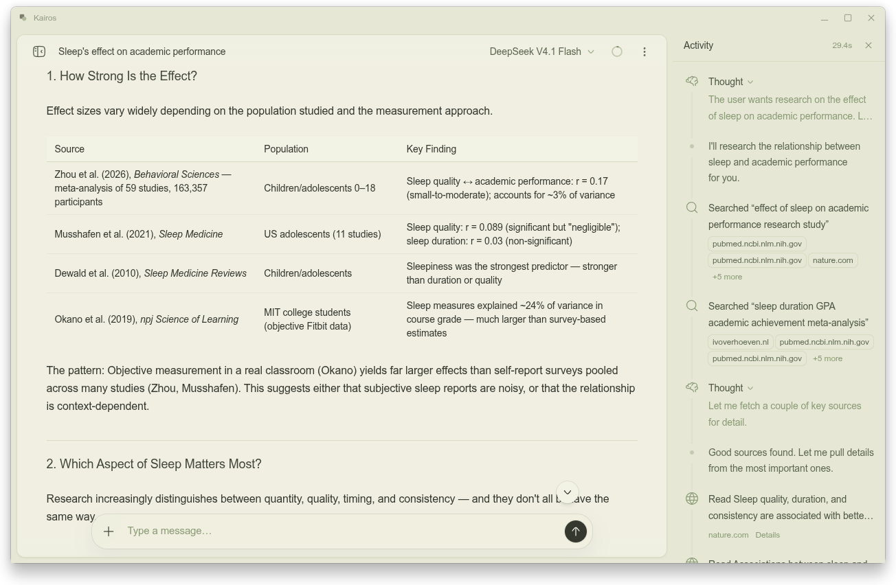
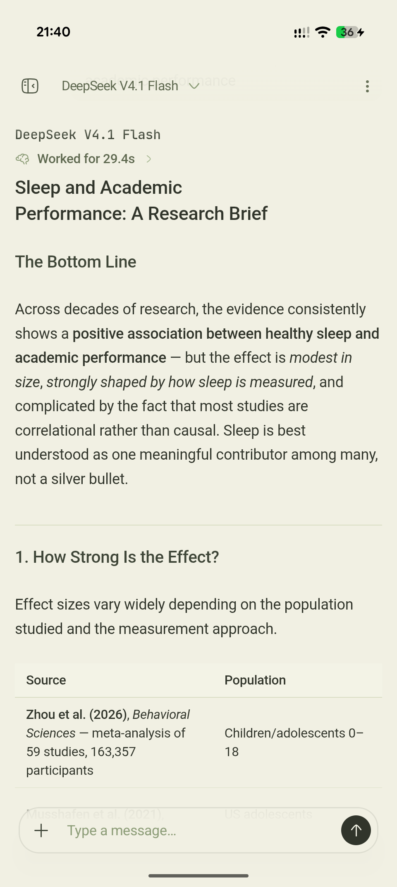
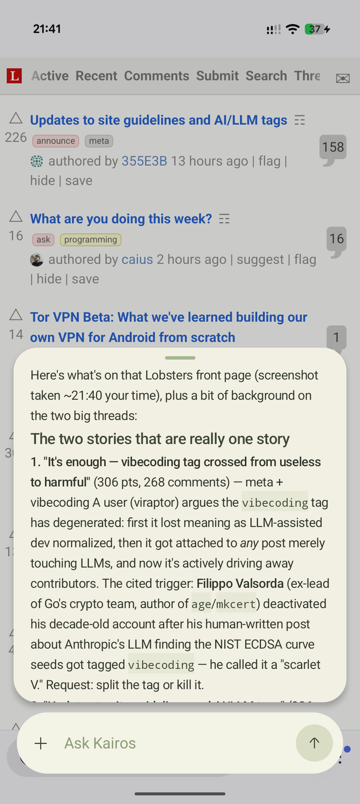

# Kairos

Kairos is a simple focused chat app for talking to LLMs.

It is a lightweight open WebUI alternative for hosted models only: no local model runtime, no heavyweight deployment, just a fast web UI and a Go server you can run as a single service.

## Screenshots

<table>
  <tr>
    <td width="50%" align="center">
      <a href="docs/screenshots/chat-default.png"></a>
      <br><sub>Desktop chat</sub>
    </td>
    <td width="50%" align="center">
      <a href="docs/screenshots/chat-activity.png"></a>
      <br><sub>Tool activity and sources</sub>
    </td>
  </tr>
  <tr>
    <td align="center">
      <a href="docs/screenshots/android-chat.png"></a>
      <br><sub>Android chat</sub>
    </td>
    <td align="center">
      <a href="docs/screenshots/android-assistant.png"></a>
      <br><sub>Android assistant</sub>
    </td>
  </tr>
</table>

## Desktop app

A Linux desktop app with a tray icon and a global hotkey is available from the
[releases page](https://github.com/thang-qt/Kairos/releases). See
[desktop/README.md](desktop/README.md) to install it.

## Run locally

```bash
pnpm install
pnpm dev
```

Copy `.env.example` to `.env` first if you want to override local defaults. `pnpm dev` starts the Vite frontend on `http://localhost:3000` and the Go backend on `http://localhost:8080`.

## Android app

The Android app connects to your Kairos server and supports an optional system
assistant overlay. See [Android installation and usage](android/README.md).

## Guides

- [Import ChatGPT conversations](docs/conversation-import.md)
- [Export conversations](docs/conversation-export.md)
- [Connect remote MCP tools](docs/remote-mcp.md)
- [Model information and pricing](docs/model-metadata.md)
- [Contributing](CONTRIBUTING.md)

## Configuration

Local environment values live in `.env`.

Common settings:

- `APP_ENV`: `development`, `test`, or `production`
- `HTTP_ADDR`: server bind address
- `KAIROS_DB_PATH`: SQLite database path
- `MAX_TOOL_CALLS`: default maximum tool-call rounds per response
- `AUTH_ENABLED`: enable authentication
- `ALLOW_SIGNUP`: allow self-service signup
- `ALLOW_REMOTE_IMPORT`: allow conversation imports from remote clients (default: `false`)
- `PROVIDER_SECRET_KEY`: encryption key for stored provider and tool credentials
- `BOOTSTRAP_ADMIN`, `ADMIN_EMAIL`, `ADMIN_PASSWORD`: initial admin account
- `ASSET_STORAGE`: image storage backend — `inline` (default), `local`, or `s3`

Production requires authentication, secure session cookies, and a
`PROVIDER_SECRET_KEY` of at least 32 characters.

See [.env.example](.env.example) for all settings, including local image paths
and S3 options.

## Production Build

```bash
pnpm build
go build ./cmd/kairosd
```

`pnpm build` writes the frontend bundle into `internal/server/static`, and the Go binary embeds those assets. The final binary serves both the SPA and `/api/*` from the same origin.

## Credits

The original interface was extracted and adapted from [webclaw](https://github.com/ibelick/webclaw) by [ibelick](https://github.com/ibelick).

## License

See [LICENSE](LICENSE).
