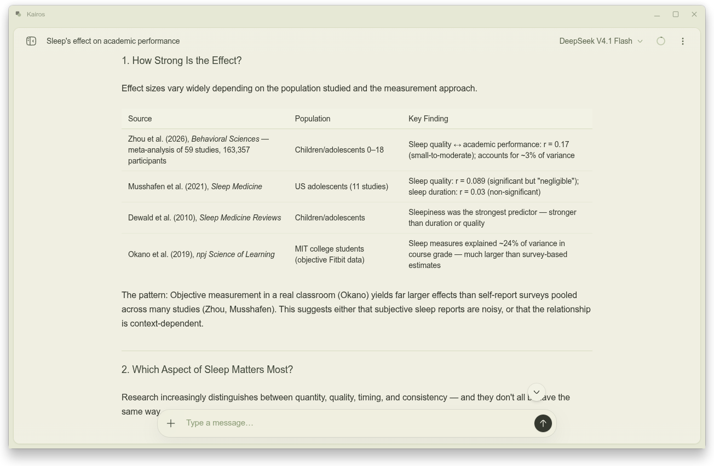
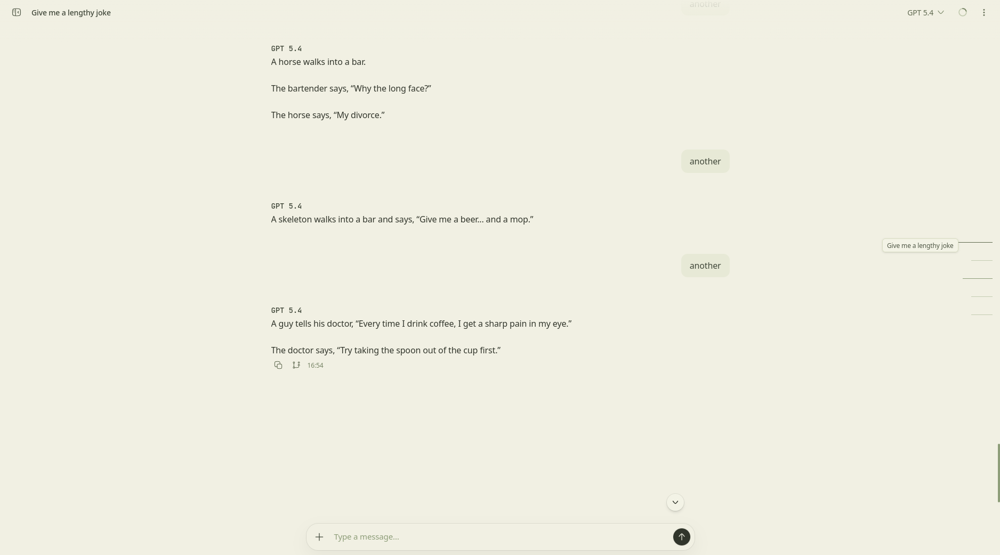
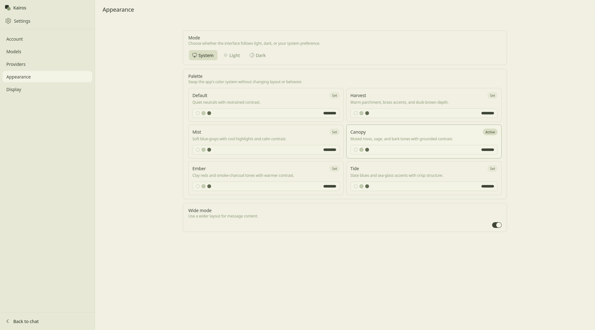

# Kairos

Kairos is a simple focused chat app for talking to LLMs.

It is a lightweight open WebUI alternative for hosted models only: no local model runtime, no heavyweight deployment, just a fast web UI and a Go server you can run as a single service.

## Screenshots







## Desktop app

A Linux desktop app with a tray icon and a global hotkey is available from the
[releases page](https://github.com/thang-qt/Kairos/releases). See
[desktop/README.md](desktop/README.md) to install it.

## Development

```bash
pnpm install
pnpm dev
```

Copy `.env.example` to `.env` first if you want to override local defaults. `pnpm dev` starts the Vite frontend on `http://localhost:3000` and the Go backend on `http://localhost:8080`.

## Configuration

Local environment values live in `.env`.

Common settings:

- `HTTP_ADDR` for the server bind address
- `KAIROS_DB_PATH` for the SQLite database path
- `MAX_TOOL_CALLS` for the default maximum tool-call rounds per response (users can override it in **Web tools** settings)
- `AUTH_ENABLED` to enable authentication
- `ALLOW_SIGNUP` to allow or block self-service signup
- `ALLOW_REMOTE_IMPORT` to enable conversation imports from remote clients (default: `false`, localhost only)
- `PROVIDER_SECRET_KEY` for encrypting stored provider credentials
- `BOOTSTRAP_ADMIN`, `ADMIN_EMAIL`, and `ADMIN_PASSWORD` for first admin setup

See [.env.example](.env.example) for the full list.

## Image storage

Images use inline base64 storage by default, preserving existing installations.
Set `ASSET_STORAGE=local` to write new images under `ASSET_LOCAL_DIR` (default
`./tmp/assets`), or use a private S3 bucket:

```dotenv
ASSET_STORAGE=s3
S3_BUCKET=your-private-bucket
S3_REGION=us-east-1
S3_PREFIX=kairos/assets
```

The server uses the standard AWS credential chain, including `AWS_ACCESS_KEY_ID`
and `AWS_SECRET_ACCESS_KEY`, shared AWS configuration, and IAM roles. Grant
`s3:PutObject`, `s3:GetObject`, `s3:DeleteObject`, and `s3:AbortMultipartUpload`
for the configured prefix. Assets larger than 5 MiB upload in 5 MiB parts, with
per-part retries and cleanup on failure or cancellation. Smaller assets use a
single PUT. Multipart uploads do not resume across server restarts; browser
uploads still use a single request and images are decoded in memory before
storage. A bucket lifecycle rule to abort incomplete multipart uploads can
clean up parts left by a server crash.
Kairos does not create buckets or make objects public. For an S3-compatible
service, set `S3_ENDPOINT` and, if needed, `S3_FORCE_PATH_STYLE=true`.

Chat attachments and imported images use the selected backend. Messages retain
stable asset IDs; authenticated `/api/assets/{assetId}` requests serve images
only to their owner. Provider requests resolve stored images to bytes on the
server, so providers do not need access to the bucket. Throwaway chats keep new
images inline and do not persist them to asset storage.

Changing `ASSET_STORAGE` affects new images only. Existing inline images remain
readable, and local and S3 readers can coexist. Keep the original local directory
and S3 bucket, endpoint, and prefix configured while those assets are in use;
changing these locations does not migrate existing objects. Back up SQLite and
asset storage together. There is no bulk migration of existing inline images.

Unused assets are collected by a background worker using durable SQLite jobs
and indexed message references. Cleanup does not scan conversation JSON on sends
or hold the conversation command lock during object deletion. Assets referenced
by cloned conversations are retained. Failed object deletions are logged and
retried after one minute, including after a restart; physical deletion is
asynchronous. The first startup after upgrading backfills references for existing
messages. After an interrupted upload, an object written before its metadata
committed can remain orphaned and require storage-level reconciliation. Run a
single Kairos server per database for asset cleanup coordination.

## Production Build

```bash
pnpm build
go build ./cmd/kairosd
```

`pnpm build` writes the frontend bundle into `internal/server/static`, and the Go binary embeds those assets. The final binary serves both the SPA and `/api/*` from the same origin.

## Credits

The original interface was extracted and adapted from [webclaw](https://github.com/ibelick/webclaw) by [ibelick](https://github.com/ibelick).

## License

See [LICENSE](LICENSE).

Conversation architecture, API contracts and upgrade notes are documented in [docs/agent-runtime.md](docs/agent-runtime.md).
